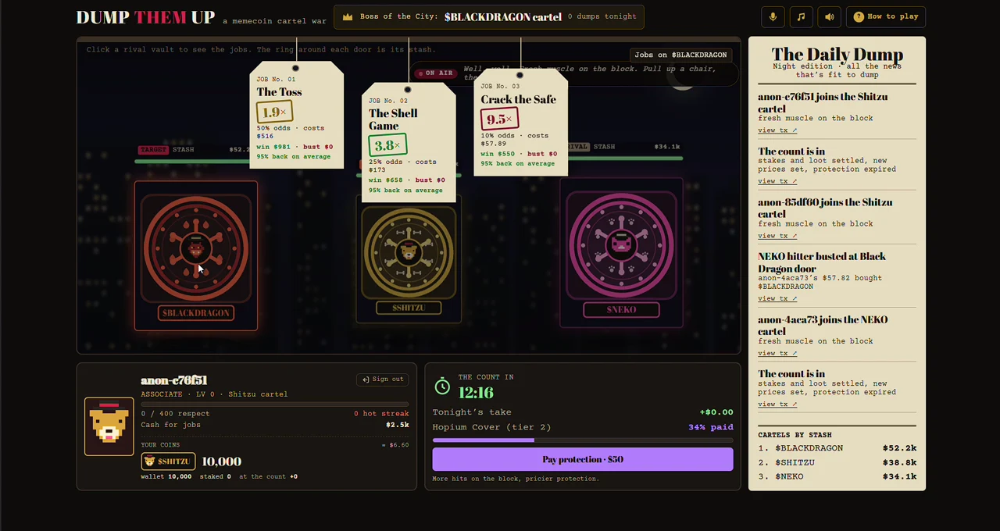
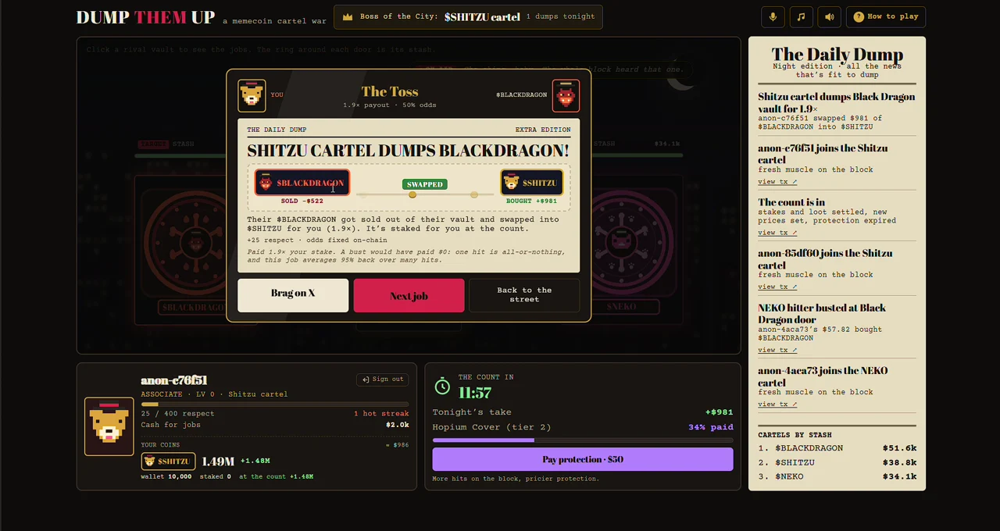
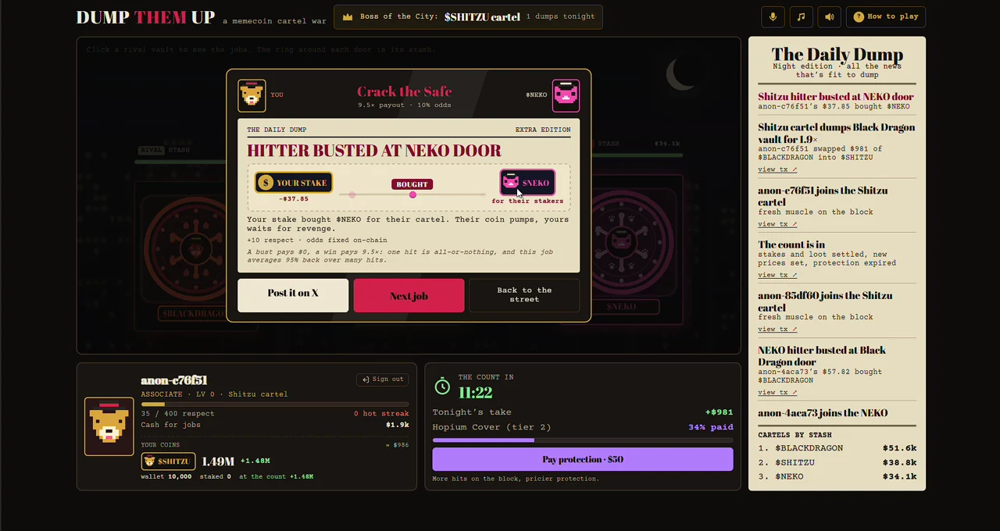

# Dump Them Up

A memecoin cartel war on NEAR. Memecoin communities run rival cartels, each with a vault of their own coin. Players hit rival vaults through three on-chain mini-games. A winning hit **dumps** the rival's coin through its pool and buys the hitter's coin with the proceeds. A failed hit buys the rival's coin for its stakers. Vaults can pay for protection, and protection gets pricier the more hits there are on the block.

**Play it:** https://dump-them-up.pages.dev (NEAR testnet). One click as a guest, no wallet needed. Or sign in with email or Google, or connect MyNearWallet or Meteor.

Built for the NEAR Hackathon (Nov 2026). Tracks: Memecoins With Mechanics, Games With Real Economies.

## Project Snapshots

**The street** with rival vaults, three raid options, and The Daily Dump.



**Raid results** showing a successful dump and a busted hit.

| Successful raid | Busted raid |
| --- | --- |
|  |  |

## Repo

| Folder | What it is | State |
| --- | --- | --- |
| `contract/` | The game contract (Rust, near-sdk 5) | Done, 12 unit tests passing incl. RTP |
| `token/` | Standard NEP-141 token for $BLACKDRAGON, $SHITZU, $NEKO and mUSD | Done |
| `bot/` | Testnet setup script, the count crank, bot cartels (Node/TS) | Done |
| `crank-worker/` | The crank as a Cloudflare Worker on a 1-minute cron | Live |
| `web/` | The game UI (Vite + React) | Done; plays on testnet when `VITE_GAME_CONTRACT` is set, otherwise on a local mock chain |
| `scripts/` | Contract build scripts | Done |

## The mechanic (all enforced in `contract/src/lib.rs`)

| Parameter | Value |
| --- | --- |
| Hitter RTP on an unprotected vault | 95% at every tier |
| Tribute to the hitter's cartel vault | 5% of cost, in expectation |
| Protocol fee | 1% |
| Max vault loss per winning hit | 1% of the vault |
| Vault locked after losing | 10% since the count started |
| Jobs | The Toss 1.9× / 50%, The Shell Game 3.8× / 25%, Crack the Safe 9.5× / 10% |
| Protection (hitter win-chance multiplier) | Copium 0.9×, Hopium 0.8×, Diamond Hands 0.6× |
| Protection price per count | base (0.2% / 0.5% / 1.2% of vault) × (1 + 5 × raid pressure) |
| Protection revenue | 80% to the count's top raiding cartel, 20% protocol |

Job cost = `0.01 × vault / (m − 0.99 + 0.05 / p)`, so a winning hit takes at most 1% of the vault and the hitter's expected return is exactly 95%.

There is no owner and no setter. Every parameter is a constant or set once in `new`. `get_config` returns them.

### Flow of a hit

1. `commit_raid(target, tier)` charges the cost in mUSD. No backing out.
2. `resolve_raid(id)` must run in a **later block**. It reads `env::random_seed()` mixed with the job id and raider. Anyone can call it.
3. **Win:** coins worth the vault loss are sold from the target's vault into its pool. The proceeds, plus the hitter's stake minus the fee, buy the hitter's cartel coin. The hitter's share is staked for them at the next count, and the tribute goes straight into their cartel vault.
4. **Bust:** the stake minus the fee buys the target's coin for the target's stakers.

### The count (epoch)

`settle_count()` can be called by anyone once the count is due. It:

- applies queued stakes, unstakes and loot;
- takes a new price snapshot (job prices and vault values use the snapshot, so they can't be moved inside a count);
- updates raid pressure;
- expires protection;
- pays the protection bounty to the cartel with the most winning hits.

## Build and test the contracts

Prerequisites (once):

```bash
rustup target add wasm32-unknown-unknown
cargo install --locked cargo-near
```

Test (native, no wasm needed):

```bash
cd contract
cargo test            # 12 tests; the RTP tests simulate 72,000 jobs and take a few minutes
```

Build wasm:

```powershell
.\scripts\build-contracts.ps1      # Windows
./scripts/build-contracts.sh       # macOS / Linux
```

## Deploy to testnet

You need a funded testnet account (about 40 NEAR covers all sub-accounts and storage).

```bash
cd bot
cp .env.example .env               # set MASTER_ACCOUNT (and MASTER_PRIVATE_KEY if not in ~/.near-credentials)
npm install
npm run setup                      # creates token/game/bot accounts, deploys, seeds pools and vaults
npm run crank                      # local crank: settles the count, runs bot cartels (not needed while the Worker runs)
npm run status                     # vaults, protection, latest events
```

`setup` writes `deployment.testnet.json` with every contract id. It is safe to re-run.

## Run the UI

```bash
cd web
npm install
npm run dev                        # http://localhost:5173
```

- With `web/.env.local` present (written by `npm run setup`), the UI plays against the testnet contract. Wallet sign-in adds a function-call key for the game, so jobs need no wallet popups.

### Ways to sign in

| Option | What the player does | Account |
| --- | --- | --- |
| **Play now as a guest** | One click | A key made in the browser and kept in `localStorage`. Implicit (64-hex) account, shown as `anon-xxxxxx` |
| **Email or Google** (Privy) | Signs in with email or Google | Privy embedded NEAR wallet (implicit account). Same account on any device |
| **NEAR wallet** | MyNearWallet or Meteor | Their own named account |

Guest and email accounts start with nothing on chain. On first sign-in the page calls `POST /fund` on the crank Worker. The Worker sends 0.06 testnet NEAR from `sponsor.dtu-59c7f8.testnet` to brand-new implicit accounts only, limited to 2 per IP per minute, and stops below 0.5 NEAR. That covers ~45 hits. Joining a cartel then gives $2,500 starter mUSD as before. These logins prepay 30 Tgas per call instead of 100: calls burn ~3 Tgas, and testnet reserves prepaid gas at ~0.001 NEAR/Tgas.

Reads and transactions fail over across `rpc.testnet.fastnear.com` → `testnet-rpc.intea.rs` → `rpc.testnet.near.org` (`web/src/deployment.json`), because FastNEAR rate-limits busy browsers. A rate limit shows in the console as a CORS error.

Email/Google uses Privy app `cmwga0spp01ei0gjq2maas4fx`. To use a different app: create one at dashboard.privy.io, allow the origins `https://dump-them-up.pages.dev` and `http://localhost:5173`, put the App ID in `privyAppId` in `web/src/deployment.json` (or `VITE_PRIVY_APP_ID`), and redeploy. Top up the sponsor with `cd bot && npm run sponsor -- --top-up 2`.
- Without it, the UI runs on a local mock chain that follows the same rules (useful for UI work and offline demos).

### Transaction links in The Daily Dump

Each headline links to its transaction on NearBlocks ("view tx ↗"). The contract can't read its own transaction hash, so the page matches each event's `ts_ms` (the block time of the receipt that emitted it) and its kind against the game's latest 25 receipts from the NearBlocks API. It fetches those at most every 15 s, only while a headline on screen has no link yet. The house crew accounts (`ember`, `pup`, `bonebag`, `whisker`, sub-accounts of the master) show by first name.

### Sound and effects

All audio runs through Web Audio (`web/src/game/sfx.ts`): an effects bus and a music bus feed a compressor and a limiter, so hits are loud without clipping. Music sits about 14 dB under the effects.

- **Synthesized in code:** coin tings each half-turn of The Toss and a clink on landing; a ratchet click per dial segment and a clunk per tumbler in Crack the Safe; a swish per bag swap and a pop when a bag opens; a ka-ching on DUMPED!, a sad trombone on BUSTED; a paper rustle and newsroom bell when a new Daily Dump headline arrives.
- **Background music** (`web/src/game/music.ts`): a quiet noir-jazz loop generated live: D minor, 84 bpm, swung walking bass, Rhodes-style comping, brushes and ride.
- **Samples:** chips and cards from Kenney's *Casino Audio* and *Interface Sounds* (CC0). The DUMPED! explosion is aim-studios' *Explosions - Pixel Art*, the busted smoke Kenney's *Particle Pack* (both CC0). See `web/public/CREDITS.md`.

**The announcer:** a late-night jazz-radio host, 34 lines recorded with Piper (open-source text-to-speech, public-domain voice *Norman*), pitched down with a warm radio treatment (`scripts/make-announcer.py`; edit the lines there and re-run). `web/src/components/hud/Announcer.tsx` decides when he talks:
- a welcome;
- after ~22 s of idling, a nudge toward the juiciest rival vault, which glows;
- reactions to wins, busts, 9.5× hits and streaks;
- a warning when your vault gets dumped or runs hot;
- count reminders.

Lines queue and never overlap (`web/src/game/announcer.ts`). Reactions wait their turn and idle chatter only plays when he's silent. He sits below the music, and an ON AIR subtitle shows what he's saying.

Audio starts on the first click. The header has separate announcer, music and sound toggles, remembered per browser.

### Share cards

"Brag on X" posts the result with a link like `/b/shitzu-dumps-neko/`. That page carries `og:`/`twitter:` tags, so X shows the matching Daily Dump card (`web/public/share/*.png`), then forwards visitors to the game. The site itself previews `web/public/og.png`. All 13 images and the 12 share pages come from `scripts/make-share-images.py` (Pillow; run `PYTHONUTF8=1 python scripts/make-share-images.py` after `npm install` in `web/`, which provides the fonts).

### The crank in the cloud

`crank-worker/` runs the crank as a Cloudflare Worker (`dump-them-up-crank`) on a one-minute cron, so the count keeps settling with no PC running. Each run settles the count when it is due, resolves jobs whose raider left, and plays a bot turn about one run in four. Bots sign with function-call keys that can only call the game contract. Their full-access keys stay in `bot/.keys/`.

```bash
cd bot && npm run worker-keys      # add game-only bot keys and store them as the Worker secret BOT_KEYS
cd crank-worker && npm install && npm run deploy
npm run tail                       # live logs
```

Don't run `npm run crank` locally while the Worker is live: both sign as the same bots and their transactions collide. Bots pay gas from about 0.5 NEAR each, which lasts roughly 10 days at this pace. Check with `npm run worker-keys -- --balances` in `bot/` (needs `MASTER_ACCOUNT=dtu-59c7f8.testnet`).

### Deploy

The UI is hosted on Cloudflare Pages (project `dump-them-up`): **https://dump-them-up.pages.dev**. To redeploy, run `deploy-cloudflare.cmd`, or from `web/` run `npm run deploy` with `CLOUDFLARE_ACCOUNT_ID` set if your wrangler login has more than one account.
